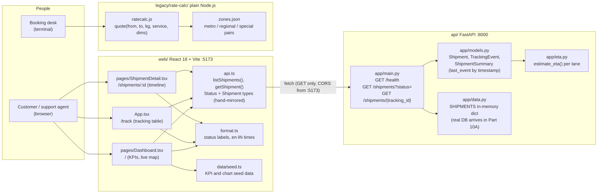
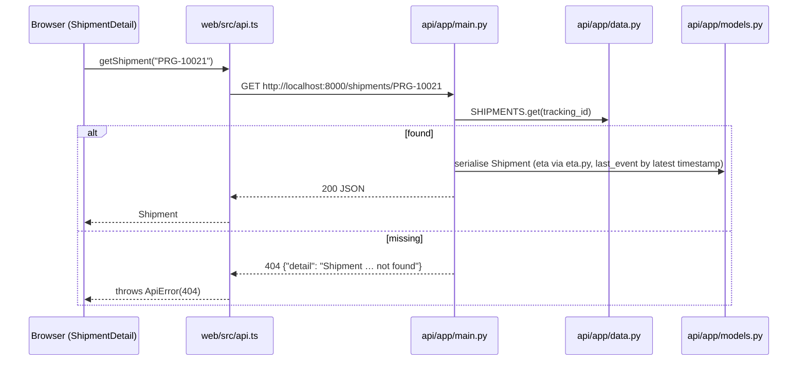

# Pragati Track architecture

Three independent programs live in this repo. Two of them talk to each other over HTTP; the third is a
stand-alone command-line tool that nothing else calls.

| Program | Folder | Runs as | Talks to |
|---|---|---|---|
| Shipments API | `api/` | FastAPI app via uvicorn on port 8000 | Nothing. Data is an in-memory dict. |
| Web app | `web/` | Vite dev server on port 5173, React in the browser | The API, over `fetch` |
| Rate calculator | `legacy/rate-calc/` | `node ratecalc.js …` at the booking desk | Nothing. Reads `zones.json` next to it. |

## Who calls what

## Request flow for one shipment

## Things worth knowing

- **No generated client.** `web/src/api.ts` mirrors the Pydantic models by hand. Change `api/app/models.py` and you
  must change `api.ts` too, and `format.ts` if a status is added.
- **Events can arrive out of order** (ticket T-4512). The list endpoint's summary uses the event with the latest
  timestamp, not the last element of the list.
- **ETA is computed, not stored** (ticket T-4527). `eta.py` adds a per-lane transit time to the latest event; delivered
  and exception shipments get `null`.
- **The dashboard mixes live and seed data.** Shipment rows come from the API; the KPI tiles, charts and network map
  come from `web/src/data/seed.ts` until there is a real analytics source.
- **The rate calculator is isolated.** Neither the API nor the web app imports it or shells out to it. Its only tests
  are the `*.test.js` files beside it, run with `node --test`. Do not change `zones.json` without asking Suresh.
- **Checking these docs.** `node docs/check-docs.mjs` from the repo root validates links and README commands. See
  the [README](../README.md).
